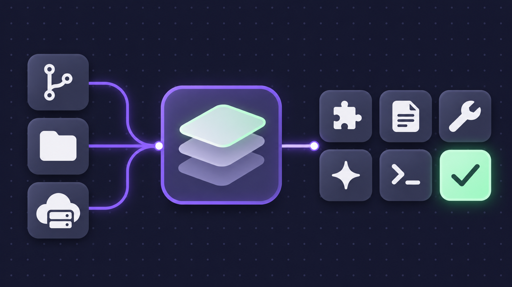

<h1 align="center">agent-skills</h1>

<p align="center"><strong>Assemble, compose, and sync Claude Code skills from GitHub, local paths, and layered overrides.</strong></p>

<p align="center">A small CLI (<code>skill-manager</code>) that turns one <code>skills.yaml</code> into installed skills — with clear precedence rules and multi-project sync.</p>

<p align="center">
  
  
  
</p>

<p align="center">
  
  <br>
  <sub><em>Many sources in, one composed set of skills out.</em></sub>
</p>

<!-- TODO: generate docs/hero.png from docs/hero-image-prompt.md -->

<p align="center">
  <a href="#features">Features</a> ·
  <a href="#installation">Installation</a> ·
  <a href="#quick-start">Quick start</a> ·
  <a href="#configuration">Configuration</a> ·
  <a href="#composable-skills">Composition</a> ·
  <a href="#cli-reference">CLI</a> ·
  <a href="#example-workflows">Workflows</a> ·
  <a href="#development">Development</a> ·
  <a href="#troubleshooting">Troubleshooting</a>
</p>

---

## Features

- **Composable skills** — merge skills from multiple sources with clear precedence rules
- **GitHub integration** — fetch skills straight from GitHub repositories
- **Smart caching** — efficient caching with configurable refresh (`--force` to bypass)
- **Multi-project support** — track and sync many config files with one command
- **Precedence system** — user-level content overrides defaults, with explicit markers in the output
- **Rich CLI** — terminal output with tables and status indicators

## Installation

```bash
uv tool install .      # recommended
pipx install .         # alternative
uv sync --dev          # for development
```

Requires Python 3.12+.

## Quick start

```bash
skill-manager init     # 1. create skills.yaml in the current directory
# 2. edit skills.yaml to define sources and skills
skill-manager sync     # 3. install skills (to .claude/skills by default)
skill-manager list     # 4. list installed skills
```

## Configuration

Config files are YAML:

```yaml
version: "1.0"

settings:
  target_dirs:
    - ".claude/skills"                   # where skills are installed
  cache_dir: "~/.cache/skill-manager"    # cache location
  default_branch: "main"                 # default git branch

sources:
  anthropic:
    type: github
    repo: "anthropics/claude-code"
    path: "skills"                       # optional: path within repo
    branch: "main"                       # optional: overrides default_branch

skills:
  # Simple skills (single source)
  - name: pdf
    source: anthropic

  - name: local-skill
    path: "./my-skills/custom-skill"

  - name: remote-skill
    url: "https://github.com/owner/repo/tree/main/path/to/skill"

  # Composed skill (multiple sources with precedence)
  - name: code-review
    description: "Custom code review with company standards"
    compose:
      - source: anthropic
        skill: code-review
        level: default
      - path: "./local-skills/code-review-overrides"
        level: user
```

**Which file is used:** commands take `--config <path>` if given, otherwise `./skills.yaml`, otherwise `~/.config/skill-manager/skills.yaml`. Settings are layered, lowest to highest: built-in defaults → `./skills.yaml` → `~/.config/skill-manager/skills.yaml` → `--config` file → [environment overrides](#environment-variables) (the `SKILL_MANAGER_*` variables are applied last, over every file) → CLI flags such as `--target`.

This repo's own `skills.yaml` installs its bundled skills (`bead-planner`, `skill-creator` from `skills/`) into both `.claude/skills` and `~/.claude/skills`.

<details>
<summary><strong>Schema reference</strong></summary>

**Root**

| Field | Type | Required | Description |
|-------|------|----------|-------------|
| `version` | string | Yes | Config schema version (must be "1.x") |
| `settings` | object | No | Global settings |
| `sources` | object | No | Named skill sources |
| `skills` | array | Yes | Skills to install |

**`settings`**

| Field | Type | Default | Description |
|-------|------|---------|-------------|
| `target_dirs` | array | `[".claude/skills"]` | Directories where skills are installed |
| `cache_dir` | string | `"~/.cache/skill-manager"` | Cache directory |
| `default_branch` | string | `"main"` | Default git branch for GitHub sources |

**`sources.<name>`**

| Field | Type | Required | Description |
|-------|------|----------|-------------|
| `type` | string | Yes | Source type (currently only `"github"`) |
| `repo` | string | Yes | Repository as `"owner/repo"` |
| `path` | string | No | Path within the repo to the skills directory |
| `branch` | string | No | Branch to fetch (overrides `default_branch`) |

**`skills[]`** — all skills:

| Field | Type | Required | Description |
|-------|------|----------|-------------|
| `name` | string | Yes | Unique skill name |
| `description` | string | No | Human-readable description |

Simple skill — exactly one of `source` (named source), `path` (local path), or `url` (direct GitHub URL). Composed skill — a `compose` array.

**`compose[]` items** — exactly one of `source`, `path`, or `url`:

| Field | Type | Required | Description |
|-------|------|----------|-------------|
| `source` | string | Conditional | Named source reference |
| `skill` | string | If `source` | Skill name within the source |
| `path` | string | Conditional | Local filesystem path |
| `url` | string | Conditional | Direct GitHub URL |
| `level` | string | No | `"default"` or `"user"` (default: `"default"`) |

</details>

## Composable skills

A skill with a `compose` array is built by:

1. Fetching/loading every listed source
2. Sorting sources by precedence level (`default` < `user`)
3. Composing markdown files with precedence markers
4. Resolving non-markdown files with user-level overrides

| Level | Role |
|-------|------|
| `default` | Base functionality and general best practices. Multiple default-level sources can be combined; their content comes first. Non-markdown files act as fallback. |
| `user` | Project/company-specific overrides. Takes priority, is clearly marked, and replaces same-named non-markdown files. |

### Markdown: concatenated with markers

`.md` files are concatenated, default first, with HTML comments marking boundaries and instructing agents to follow user-level content on conflict:

```markdown
<!-- PRECEDENCE: default -->
<!-- The following content is from the default-level skill -->

# Code Review Skill

[Content from anthropic/claude-code code-review skill]

<!-- PRECEDENCE: user (overrides default) -->
<!-- The following content is from the user-level skill and takes priority -->
<!-- When conflicts exist, follow the user-level instructions below -->

# Company Code Review Standards

[Content from your company override skill]
```

### Other files: user wins

If a user-level file has the same name it is used; otherwise the default-level file is. Relative directory structure is preserved.

```
default-skill/            user-skill/             composed-skill/
  SKILL.md                  SKILL.md                SKILL.md      # concatenated with markers
  examples.sql              schema.sql              examples.sql  # from default (no override)
  schema.sql                                        schema.sql    # from user (overrides default)
```

## CLI reference

| Command | Purpose |
|---------|---------|
| `skill-manager init [PATH]` | Create a `skills.yaml` template (default `./skills.yaml`; `--force` overwrites) |
| `skill-manager sync` | Assemble and install all skills from the config |
| `skill-manager sync-all` | Sync every tracked config |
| `skill-manager list` | List installed skills |
| `skill-manager remove <skill>` | Remove an installed skill |
| `skill-manager validate` | Validate config and show a summary of sources, skills, targets |
| `skill-manager config add <path>` | Track a config file for `sync-all` |
| `skill-manager config list` | List tracked configs |
| `skill-manager config remove <path>` | Untrack a config file |

**Options**

| Command | Options |
|---------|---------|
| `sync` | `--config/-c <path>`, `--target/-t <dir>`, `--dry-run`, `--force` (bypass cache) |
| `sync-all` | `--dry-run`, `--force` |
| `list` | `--config/-c <path>`, `--target/-t <dir>` |
| `remove` | `--config/-c <path>`, `--target/-t <dir>`, `--force` (skip confirmation) |
| `validate` | `--config/-c <path>` |

```bash
skill-manager sync                                   # default config
skill-manager sync --config ~/projects/myapp/skills.yaml
skill-manager sync --dry-run                         # preview
skill-manager sync --force                           # bypass cache
skill-manager sync-all --dry-run                     # preview across projects
skill-manager remove pdf --force
skill-manager init ~/.config/skill-manager/skills.yaml
```

`list` prints a table of names, descriptions, and install timestamps:

```
Target: /path/to/.claude/skills

┏━━━━━━━━━━━━━┳━━━━━━━━━━━━━━━━━━━━━━━━━┳━━━━━━━━━━━━━━━━━┓
┃ Name        ┃ Description             ┃ Installed At    ┃
┡━━━━━━━━━━━━━╇━━━━━━━━━━━━━━━━━━━━━━━━━╇━━━━━━━━━━━━━━━━━┩
│ pdf         │ PDF analysis skill      │ 2026-02-08 10:30│
│ code-review │ Custom code review      │ 2026-02-08 10:30│
└─────────────┴─────────────────────────┴─────────────────┘
```

Tracked configs are stored in `~/.config/skill-manager/tracked-configs.yaml`. `config list` shows what `sync-all` will touch:

```
Tracked configs: (2)

✓ /Users/user/projects/project-a/skills.yaml
✓ /Users/user/projects/project-b/skills.yaml
```

## Example workflows

### Add a simple skill

```bash
cat >> skills.yaml << 'EOF'
  - name: pdf
    source: anthropic
EOF
skill-manager sync
skill-manager list
```

### Build a composed skill (defaults + company standards)

```bash
# 1. Local override skill
mkdir -p ./company-skills/code-review
cat > ./company-skills/code-review/SKILL.md << 'EOF'
---
name: company-code-review
description: Company coding standards
---

# Company Standards

Always follow these company-specific rules:

1. All functions must have type hints
2. Use Google-style docstrings
3. Security review required for auth changes
EOF

# 2. Add the composed skill to the config
cat >> skills.yaml << 'EOF'
  - name: code-review-enhanced
    description: "Code review with company standards"
    compose:
      - source: anthropic
        skill: code-review
        level: default
      - path: "./company-skills/code-review"
        level: user
EOF

# 3. Compose, install, and inspect
skill-manager sync
cat .claude/skills/code-review-enhanced/SKILL.md
```

The result is default guidance followed by your standards, separated by precedence comments.

### Layer several defaults under one override

```yaml
skills:
  - name: sql-expert
    description: "Comprehensive SQL with company standards"
    compose:
      - source: community          # base knowledge (default)
        skill: sql-basics
        level: default
      - source: community          # advanced techniques (default)
        skill: sql-advanced
        level: default
      - path: "./company-skills/sql-standards"   # takes priority
        level: user
```

Default content (basics + advanced) comes first, user content follows with override markers, a user `schema_template.sql` replaces any default one, and scripts/configs follow user-wins.

### Multi-project setup

```bash
cd ~/projects/project-a
skill-manager init              # ...edit skills.yaml...
skill-manager config add ./skills.yaml
skill-manager sync

cd ~/projects/project-b
skill-manager init              # ...edit skills.yaml...
skill-manager config add ./skills.yaml
skill-manager sync

skill-manager sync-all          # later: sync everything at once
skill-manager config list
```

### GitHub URLs and private repos

```yaml
skills:
  - name: my-skill
    url: "https://github.com/owner/repo/tree/main/skills/my-skill"
```

```bash
export GITHUB_TOKEN="ghp_your_token_here"   # optional: private repos, higher rate limits
skill-manager sync
```

## Installed layout

```
target_dir/
├── .skill-manager-manifest.json   # registry of installed skills
└── skill-name/
    ├── SKILL.md            # main skill documentation
    └── [other files]       # scripts, configs, examples, etc.
```

## Environment variables

| Variable | Purpose |
|----------|---------|
| `GITHUB_TOKEN` | GitHub personal access token for private repositories (optional) |
| `SKILL_MANAGER_CACHE_DIR` | Overrides `settings.cache_dir` |
| `SKILL_MANAGER_DEFAULT_BRANCH` | Overrides `settings.default_branch` |
| `SKILL_MANAGER_TARGET_DIRS` | Overrides `settings.target_dirs` (comma-separated) |

## Development

```
agent-skills/
├── src/skill_manager/
│   ├── cli.py              # CLI commands and entry point
│   ├── config/             # configuration schema and loading
│   ├── core/               # core models (Skill, Registry, Resolver)
│   ├── compose/            # composition logic (markdown, files, assembler)
│   ├── fetch/              # fetchers (GitHub, cache)
│   └── utils/              # utilities (paths, output)
├── skills/                 # skills authored/bundled here (bead-planner, skill-creator)
├── tests/                  # test suite
├── examples/               # usage examples
└── pyproject.toml          # project metadata
```

```bash
uv sync --dev                       # install dev dependencies
uv run pytest                       # run tests
uv run pytest --cov=skill_manager   # with coverage
uv build                            # build the package
uv pip install -e .                 # editable install
```

Contributions are welcome — please make sure tests pass (`uv run pytest`), new features include tests, and docs are updated.

## Troubleshooting

| Problem | Fix |
|---------|-----|
| "No configuration file found" | Run `skill-manager init`, or pass `--config path/to/skills.yaml` |
| Validation errors | Run `skill-manager validate --config ./skills.yaml` |
| Stale or odd results | `skill-manager sync --force` to bypass the cache (default `~/.cache/skill-manager`, configurable in settings) |
| GitHub rate limiting | `export GITHUB_TOKEN=...` then re-run `skill-manager sync` |

## License

No `LICENSE` file has been added to this repository yet.

## Author

Aaron Brooks — [@scalefreegan](https://github.com/scalefreegan)
